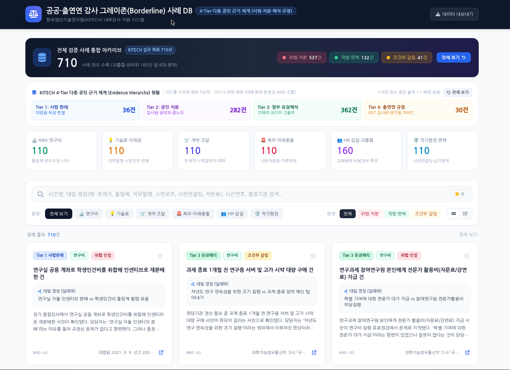
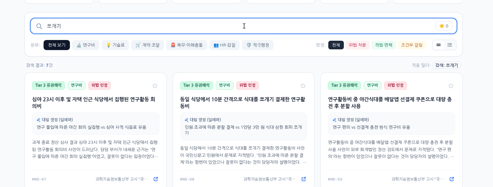
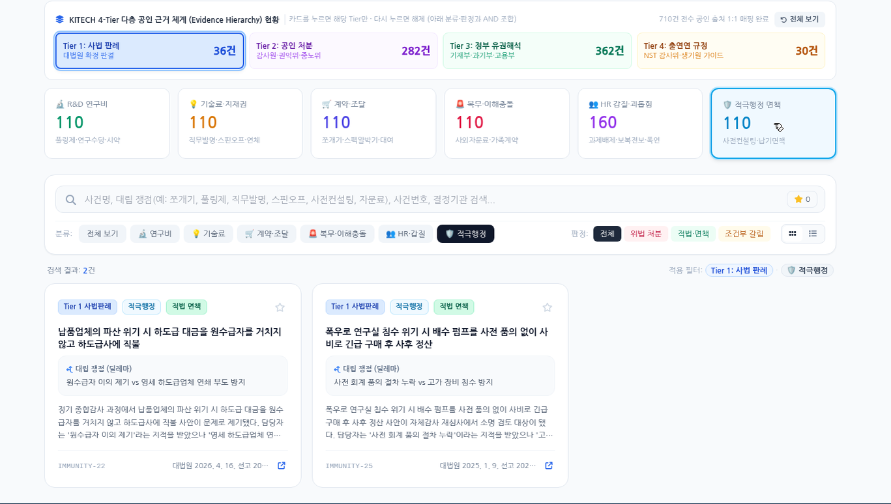
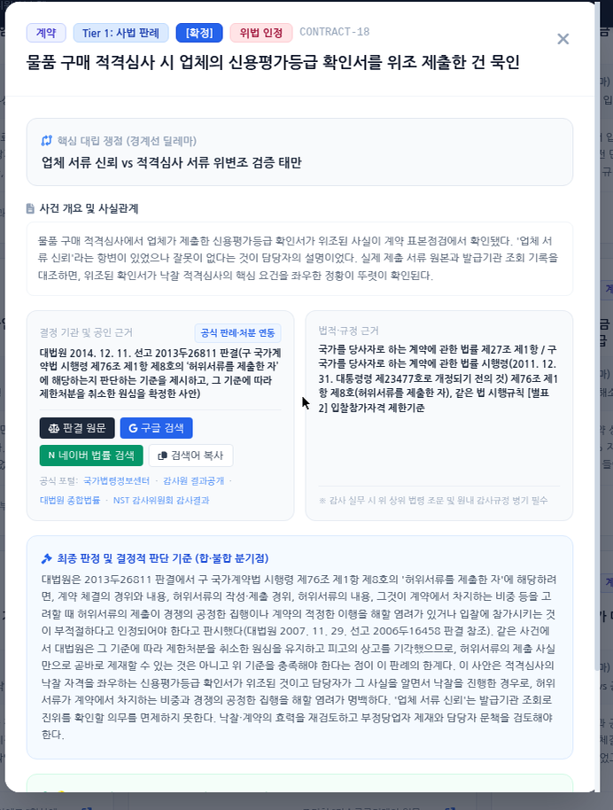
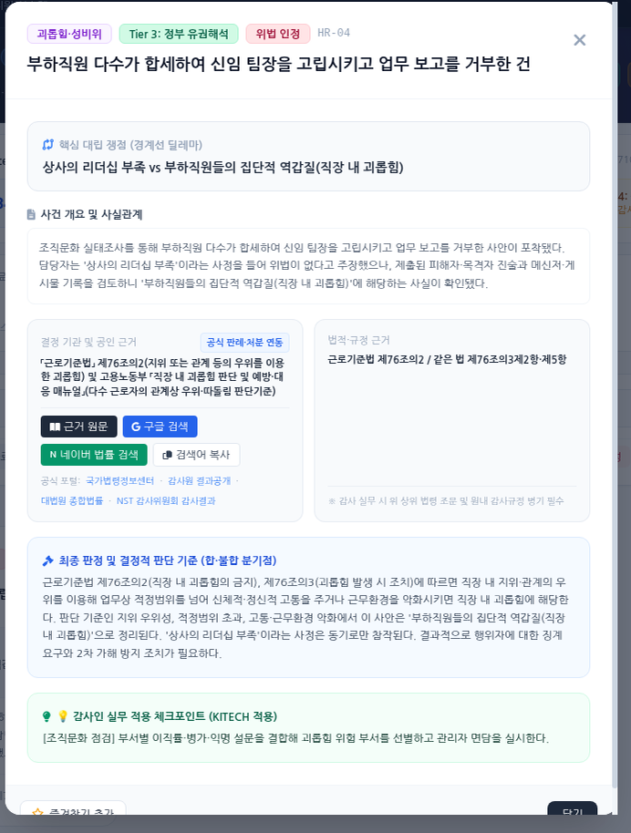

# [사용자 가이드] KITECH 감사 그레이존 사례 DB (710선) 활용 매뉴얼

> **시스템 명칭**: 공공·출연연 감사 그레이존(Borderline) 사례 DB  
> **부제**: 한국생산기술연구원(KITECH) 내부감사 지원 시스템 (실무 특화 710선)  
> **문서 버전**: **v1.2** (기준일 **2026-11-17**) · 실서비스 https://audit-grayzone-db.vercel.app/  
> **핵심 요약**: 일반 단어 검색 한 번으로 **공인 근거 710선 필터링 ➡️ 법제처·구글·네이버 원문 직결 ➡️ AI 법리 분석 및 김비서 캡처 연동**까지 한 번에 완결하는 실무 매뉴얼입니다.

---

## 📌 한눈에 보는 수록 현황 (2026-11-17 실서비스 화면 기준)

| 구분 | 내역 |
|---|---|
| 전체 수록 | **710건** |
| 최종 판정 | 위법 인정 **538** · 적법 면책 **132** · 조건부 갈림 **40** |
| 4-Tier 공인 근거 | Tier 1 **34** · Tier 2 **283** · Tier 3 **363** · Tier 4 **30** |
| Tier 1 판결 상태 배지 | `[확정]` **10** · `[파기환송]` **22** · `[1심]` **2** |
| 6대 핵심 분야 | 연구비 **109** · 기술료 **110** · 계약 **110** · 복무·이해충돌 **110** · 괴롭힘·성비위 **161** · 적극행정 **110** |

> 위 수치는 웹앱 상단 통합 아카이브 카드·4-Tier 배너·6대 분야 카드에 표시되는 값과 같습니다. 화면 안내서(웹)는 상단 `[사용설명서]` 버튼으로 열리는 `guide.html` **v1.3**이며, 이 문서와 같은 기준일(2026-11-19)로 동기화되어 있습니다.

---

## 📌 핵심 활용 3단계 흐름

```
[1단계] 자연어 검색      ➡️   [2단계] 원문 1-클릭 직결      ➡️   [3단계] AI 법리 분석 & 김비서 캡처
일상 단어로 판례 실시간 필터링     판결 원문·근거 원문·구글 AI 개요 직결   화면 캡처 전송 시 핵심 법리·조서 도출
```

---

## STEP 1. 자연어 검색 (단어 하나로 710선 실시간 필터링)

사건번호나 법률 전문 용어를 외울 필요가 없습니다. 현업에서 쓰시는 일상적인 업무 단어만 검색창에 입력하면 관련 판례만 즉시 화면에 남습니다.





1. **상단 통합 현황 확인**:
    - 전체 **710건** (위법 인정 **538**건 / 적법 면책 **132**건 / 조건부 갈림 **40**건)
    - **4-Tier 다층 공인 근거 체계** (상단 배너 카드에 실제 수록 건수 표시):
        - `Tier 1`: 사법 판례 — 확정·파기환송·1심 구분 (**34건**)
        - `Tier 2`: 공인 처분 — 감사원·권익위·중노위 (**283건**)
        - `Tier 3`: 정부 유권해석 — 기재부·과기부·고용부 (**363건**)
        - `Tier 4`: 출연연 규정 — NST 감사위·생기원 가이드 (**30건**)
    - **6대 핵심 감사 영역**: 🔬 연구비(**109**) / 💡 기술료(**110**) / 🛒 계약(**110**) / 🚨 복무·이해충돌(**110**) / 👥 괴롭힘·성비위(**161**) / 🛡️ 적극행정(**110**)
    - **근거 원칙**: 사건번호는 해당 판결의 실제 판시 사안과 사실관계가 1:1로 일치하는 사례에만 표기하고(사법 판례 34건), 그 밖의 사례는 사안을 직접 규율하는 법령 조문·부처 고시·공식 매뉴얼로 1:1 매핑했습니다. Tier 1 사건번호 34건은 법제처 국가법령정보센터 Open API로 판시사항·판결요지·참조조문 원문을 확인한 뒤 1:1로 대조해 등재했고, 카드의 `[판결 원문]` 버튼은 해당 판결 상세페이지(precSeq)로 연결됩니다. Tier 2~4 676건의 `[근거 원문]` 버튼은 구글 검색이 아니라 법제처의 해당 법령·행정규칙 본문(또는 감사원·고용노동부 공식 페이지)으로 바로 연결됩니다.
2. **자연어 검색창 활용**:
    - 검색창에 궁금한 단어(예: `학생인건비 풀링`, `출장 식대`, `쪼개기 계약`, `자문료`)를 입력합니다.
    - 글자를 치는 즉시 710건 중 해당 판례만 실시간으로 압축 표시됩니다.
3. **4-Tier 카드 클릭 → 분류와 조합 필터링** (가장 빠른 탐색 경로):
    - 상단 4-Tier 배너의 카드를 클릭하면 그 Tier 자료만 남습니다(선택된 카드는 테두리·배경으로 강조).
    - 이어서 바로 아래 6대 영역 카드(예: `적극행정`)나 분류 버튼·판정 버튼을 클릭하면 **두 조건이 AND로 조합**되어 표시됩니다(예: `Tier 1` + `적극행정` = **2건**, 아래 화면).
    - 같은 카드를 다시 클릭하면 해당 조건이 해제되고, Tier를 유지한 채 분류만 바꿀 수도 있습니다.
    - 조합 결과가 0건이면 적용 조건과 교집합 건수를 안내하고 `[필터 전체 초기화]` 버튼을 제공합니다. 배너 우측 `전체 보기`를 누르면 모든 조건이 한 번에 초기화됩니다.
    - 현재 적용 중인 조건은 결과 건수 옆에 `Tier 1: 사법 판례 · 🛡️ 적극행정`처럼 칩으로 표시됩니다.



### Tier 1 판결 상태 배지 — `[확정]` 10 · `[파기환송]` 22 · `[1심]` 2

Tier 1 사법 판례 34건은 카드와 팝업에 **그 판결이 어느 단계에서 어떤 상태로 남았는지**를 배지로 함께 표시합니다. 같은 판례라도 확정된 판결과 하급심 판결은 인용의 무게가 다르므로, 결론을 인용하기 전에 이 배지를 먼저 확인하시면 됩니다.

| 배지 | 건수 | 뜻 | 인용할 때 |
|---|---|---|---|
| `[확정]` | **10** | 상고기각 등으로 판결이 확정되어, 당사자에 대한 결론이 그대로 남은 판결입니다. | 결론까지 그대로 인용할 수 있는 가장 단단한 근거입니다. |
| `[파기환송]` | **22** | 대법원이 원심을 파기하고 사건을 하급심으로 돌려보낸 판결입니다. 판시한 법리(판단 기준)는 그대로 유효하지만, 그 사건의 최종 결론은 확정되지 않았습니다. | 법리·판단 기준은 인용하되 “대법원 파기환송 판결”임을 함께 적고, 당사자에 대한 결론은 인용하지 않습니다. |
| `[1심]` | **2** | 서울행정법원 등 1심(하급심) 판결입니다. | 논거로 쓸 수는 있지만 상급심에서 달라질 수 있으므로, 심급을 밝히고 후속 심급을 확인합니다. |

> 상태 배지는 **Tier 1 사법 판례에만** 붙습니다. Tier 2~4 사례 676건의 팝업에는 Tier 배지 옆에 상태 배지가 없고, 분류·Tier·판정 배지만 보입니다.

---

## STEP 2. 원문 1-클릭 직결 확인 (판결 원문 · 근거 원문 · 구글 · 네이버)

검색된 판례 카드를 클릭하면 상세 팝업이 열리며, 검증 버튼으로 공식 원문과 검색 결과에 즉시 연결됩니다. **Tier 4(출연연 내부규정 30건)는 첫 버튼이 `[KITECH 규정 조문]`** 으로 바뀌어, 클릭하면 규정명·조문 번호·조문 요지가 담긴 원내규정 팝업이 열립니다.





1. **핵심 쟁점 & 사실관계 확인**:
    - 피조사자 항변 논리와 적발 사유 간 '경계선 딜레마' 확인
    - 관료적 수식어 없이 정제된 객관적 사건 사실관계 확인
2. **최종 판정 및 결정적 판단 기준**:
    - 합·위법을 가른 법리적 분기점(Turning Point)과 법적 근거 조항 확인
3. **💡 감사인 실무 적용 체크포인트 (KITECH 적용)**:
    - KITECH 내부 감사인이 일상감사 사전 예방 및 실지 조사 시 즉시 적용해야 할 실무 행동 지침 확인
4. **팝업 하단 검증 버튼**(Tier 1~3 4개, Tier 4 5개)으로 원문을 대조합니다(아래 표 — 첫 버튼은 Tier에 따라 `[판결 원문]` · `[KITECH 규정 조문]` · `[근거 원문]`).

### 팝업 하단 검증 버튼 — 실제 화면 버튼명

| 버튼 | 보이는 사례 | 누르면 | 이렇게 쓰세요 |
|---|---|---|---|
| `[판결 원문]` | Tier 1 (34건 전부) | 법제처 국가법령정보센터의 **해당 판결 상세페이지**가 새 창으로 열립니다. | 판시사항·판결요지·참조조문을 원문 그대로 확인. 인용 전 필수. |
| `[KITECH 규정 조문]` | Tier 4 (30건 전부) | 규정명 · 조문 번호 · 조문 요지가 담긴 **원내규정 조문 팝업**이 열립니다. 조문이 2개 이상인 사례는 전부 나열되며, `[조문 요지 복사]`로 조서에 바로 붙여넣을 수 있습니다. | 원내 규정 위반 여부를 직접 판단할 때 근거 조문을 확인. 감사조서에는 상위 법령과 원내규정 조문을 병기합니다. |
| `[근거 원문]` | Tier 2~3 (646건) | 법제처의 **해당 법령·행정규칙 본문**(또는 감사원·NST 감사결과·고용노동부 매뉴얼 등 공식 페이지)으로 바로 갑니다. 공개 원문이 없는 원내규정·처분요구 유형은 감사원·NST 감사결과 또는 국가법령정보센터 검색으로 연결됩니다. | 조문 번호와 문구를 원문에서 확인. 연결 대상은 버튼에 마우스를 올리면 표시됩니다. |
| `[구글 검색]` | 모든 사례 | 판결 사건번호·근거 문구로 구글 검색 결과가 열립니다. | 구글 AI 개요(AI Overview)로 법리 흐름을 빠르게 잡을 때(원문 대조는 `[판결 원문]`·`[근거 원문]`으로). |
| `[네이버 법률 검색]` | 모든 사례 | 네이버에서 같은 검색어로 법률정보·판례를 찾아 줍니다. | 조문 전문·유사 판례를 한글 자료 위주로 훑을 때. |
| `[검색어 복사]` | 모든 사례 | 정제된 검색어(근거 문구 + 사건명)가 클립보드에 복사되고, 버튼 문구가 잠시 `복사 완료! ✓`로 바뀝니다. | 국가법령정보센터·감사원 결과공개·NST 감사위원회에서 직접 조회할 때 붙여넣기. |

- 화면에서는 첫 버튼이 `[판결 원문]`(Tier 1) · `[KITECH 규정 조문]`(Tier 4) · `[근거 원문]`(Tier 2~3)이고, 여기에 `[구글 검색]` · `[네이버 법률 검색]` · `[검색어 복사]`가 함께 붙어 있습니다(Tier 1~3은 4개, Tier 4는 5개 — 모바일에서는 2열로 접혀 보입니다).
- Tier 4 카드·테이블에는 `[규정 조문]` 버튼이 따로 있어, 팝업을 열지 않고도 원내규정 조문을 바로 볼 수 있습니다.
- ‘결정 기관 및 공인 근거’ 칸 아래에는 **공식 포털 바로가기**(국가법령정보센터 · 감사원 결과공개 · 대법원 종합법률 · NST 감사위원회 감사결과)가 고정으로 붙어 있습니다.

---

## STEP 3. AI 법리 분석 및 김비서 연동 (화면 캡처 즉시 처리)

외부 별도 AI 사이트를 찾아 헤맬 필요가 없습니다. 본 판례 DB 화면을 보시다가 심층 법리 분석이나 맞춤형 감사 조서 작성이 필요할 때 김비서를 바로 활용하시면 됩니다.

1. **화면 캡처 전송**: 판례 DB 화면이나 팝업 화면을 캡처하여 대화창에 올려주시면, 김비서가 이미지 캡처를 직접 판독합니다.
2. **핵심 법리 즉시 추출**: 해당 판례의 쟁점에 대해 대법원 리딩 판례와 감사원 처분 기준을 대조하여 핵심 법리를 요약해 드립니다.
3. **감사 조서·의견서 원스톱 작성**: "이 사안에 대해 KITECH 일상감사 검토 의견서 써줘" 또는 "문답서 질문지 뽑아줘"라고 말씀하시면 실무 감사 서식에 맞춰 즉시 작성해 드립니다.

---

## 📘 화면 안내서(`guide.html`) 연동 — 헤더 `[사용설명서]` 버튼

| 항목 | 내용 |
|---|---|
| 여는 방법 | 웹앱 상단 헤더 오른쪽 **`[사용설명서]`** 버튼 → PC는 **새 창**, 모바일·팝업 차단 환경은 **화면 위 모달**로 열립니다. |
| 직접 주소 | https://audit-grayzone-db.vercel.app/guide.html |
| 문서 버전 | **v1.3** (기준일 **2026-11-19**) — 이 문서(USER_GUIDE.md)와 동일 기준으로 동기화 |
| 화면 캡처 | 화면 5장은 2026년 11월 17일 실서비스 화면입니다. 2026-11-19 Tier 4 버튼 개편은 캡처에 나오는 Tier 1·Tier 3 화면에 영향이 없습니다(각 이미지를 클릭하면 원본 크기). |
| 저장·인쇄 | 설명서 상단 `[인쇄 / PDF 저장]` — 브라우저 인쇄로 PDF 보관이 가능합니다. |
| 데이터 내보내기 | 헤더 `[데이터 내보내기]` — 710건 전체를 JSON 파일로 내려받습니다(연구·분석용). |

**v1.3 개정 내역(2026-11-19)**: Tier 4 30건의 주 근거 버튼을 `[KITECH 규정 조문]`으로 개편 — 규정명·조문 번호·조문 요지 팝업(조문 요지 복사 지원), 기존 법령 원문 링크는 보조 버튼으로 분리, 카드·테이블에는 `[규정 조문]` 바로보기 버튼 추가.

**v1.2 개정 내역(2026-11-17)**:Tier 1 판결 상태 배지(`[확정]`·`[파기환송]`·`[1심]`) 읽는 법 추가, 판정·분류 라벨과 Tier·분야 건수를 실서비스(34·283·363·30 / 538·132·40)와 전수 동기화, 검증 버튼 4종을 실제 버튼명(`[판결 원문]`·`[근거 원문]`·`[구글 검색]`·`[네이버 법률 검색]`·`[검색어 복사]`)으로 통일, 화면 5장 재촬영, 모달 열람 시 상단 바 1줄화.

---
*한국생산기술연구원(KITECH) 감사실 · 감사 그레이존 사례 DB (710선) · 문서 v1.3 (기준일 2026-11-19)*  
*수록 710건 · 4-Tier 34 / 283 / 363 / 30 · 6대 분야 109 · 110 · 110 · 110 · 161 · 110 · Tier 1 판결 상태 `[확정]` 10 · `[파기환송]` 22 · `[1심]` 2*
